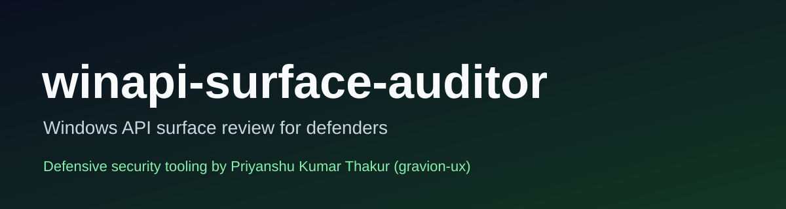

# winapi-surface-auditor

Defensive code-review tool that scans C/C++ source for Windows API usage
patterns associated with cross-process injection, input interception and
legacy process creation — and explains the safer alternative for each hit.

Built as applied coursework: understanding offensive API surface is what
makes the defensive review possible. This tool is for reviewing code you
own or are authorised to audit. It contains no exploit code.

## Install

```bash
pip install -e .
```

Requires Python 3.11+.

## Usage

```bash
winapi-surface-auditor src/*.cpp
winapi-surface-auditor main.cpp --format json
```

Each finding reports the API, category, severity, line, why the pattern is
risky, and a safer alternative (for example, documented IPC instead of
cross-process memory writes).

## Tests

```bash
pytest
```

## License

MIT
